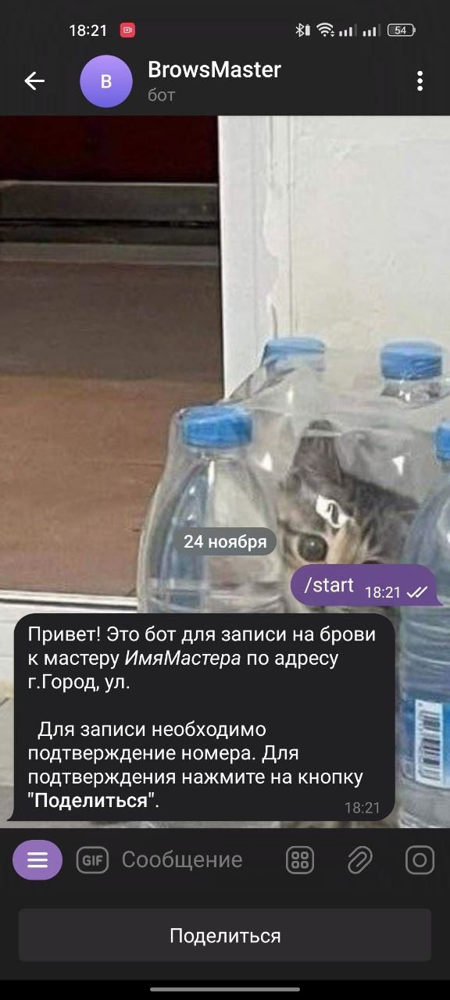
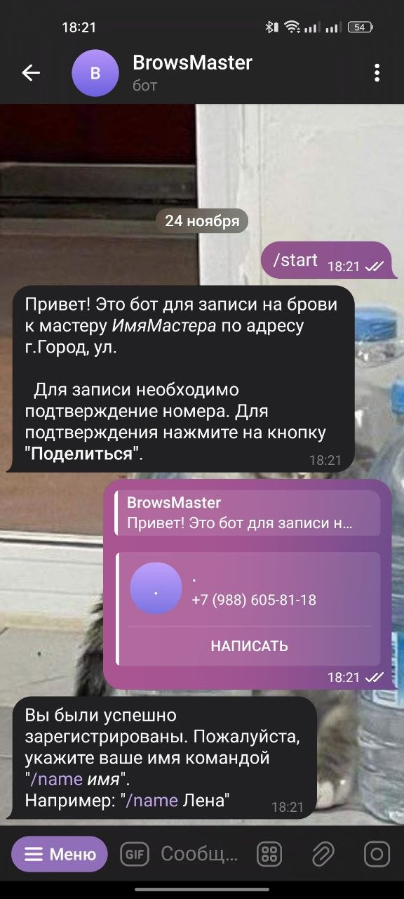
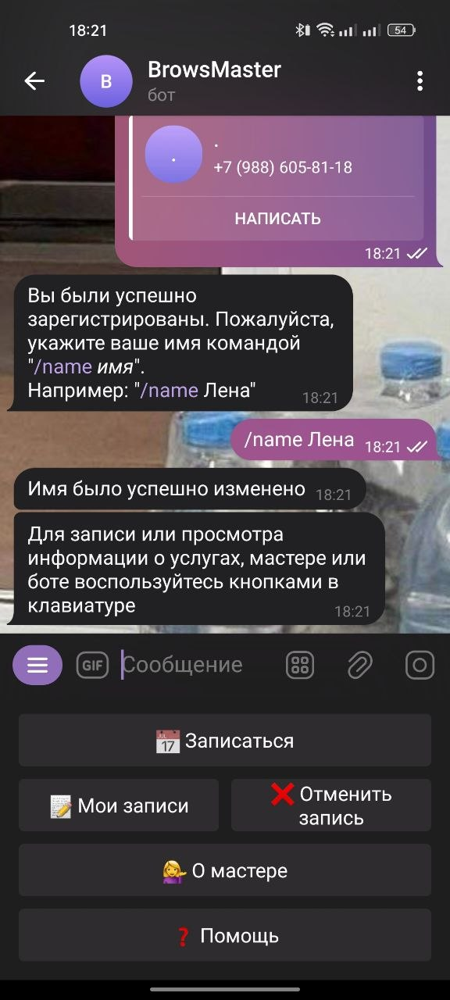
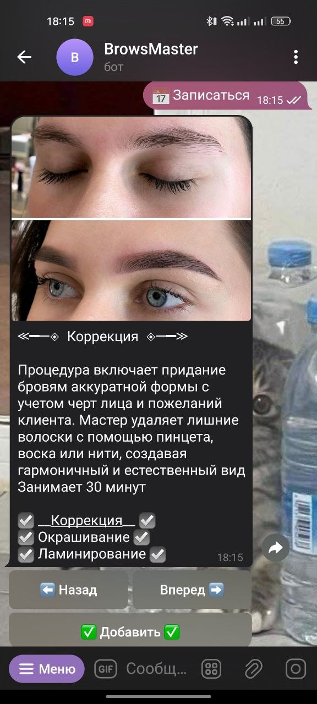
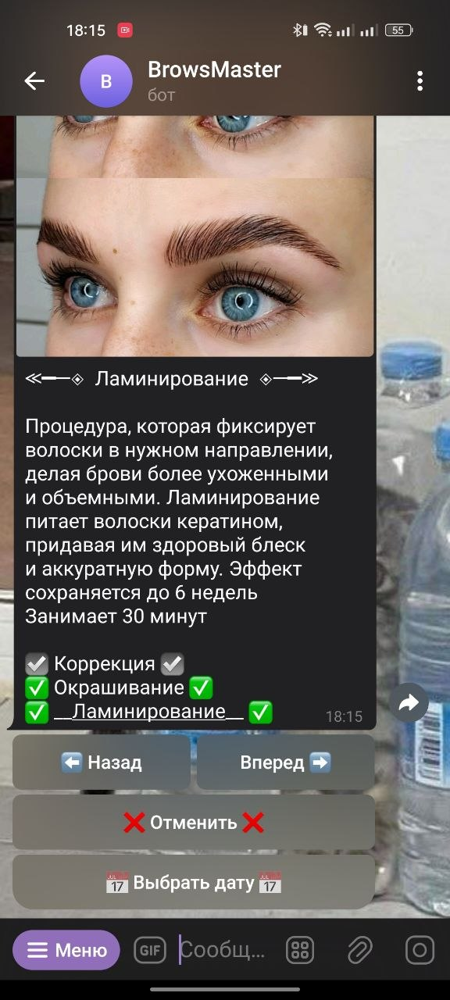
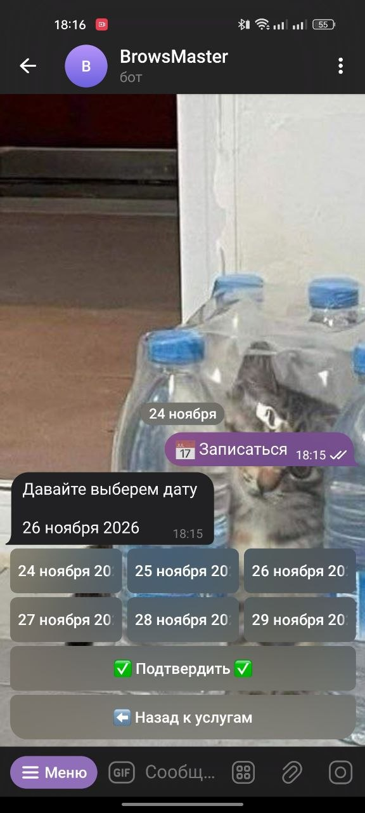
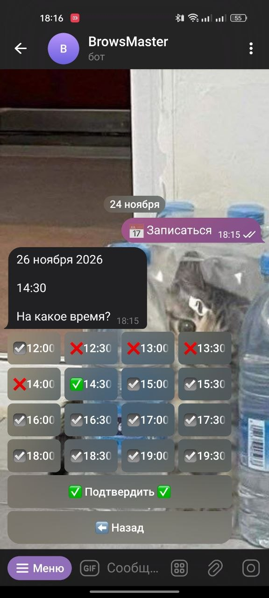
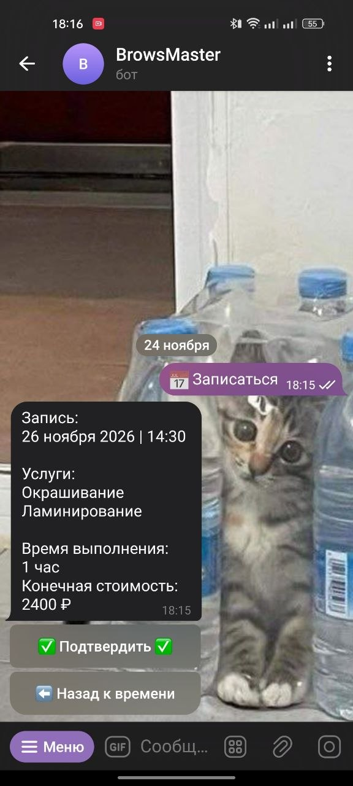
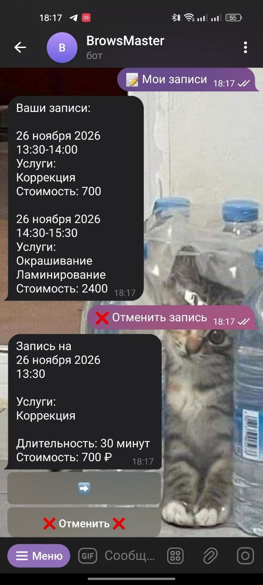
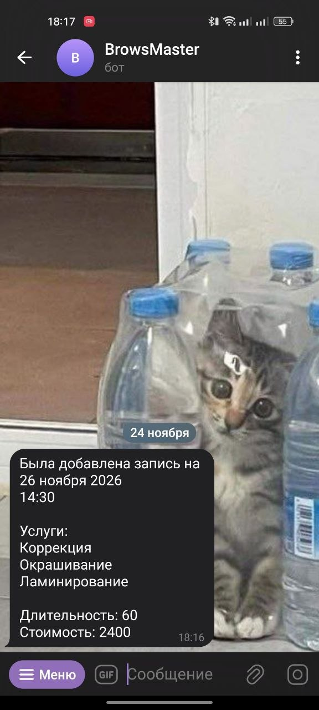

# BrowsMasterManager

<p align="center">
  <b>Telegram-бот для автоматизации записи клиентов к brow-мастеру</b>
  <br>
  Выбор услуг, расчёт стоимости и продолжительности процедур, запись на удобное время и управление записями.
</p>

<p align="center">
  
  
  
  
</p>

---

## О проекте

**BrowsMasterManager** — Telegram-бот, предназначенный для автоматизации процесса записи клиентов к мастеру по оформлению бровей.

Приложение позволяет клиентам самостоятельно ознакомиться с перечнем услуг, выбрать необходимые процедуры, рассчитать их общую стоимость и продолжительность, подобрать удобную дату и время, а также управлять своими записями.

После создания новой записи мастер получает соответствующее уведомление в Telegram.

[Открыть Telegram-бота](https://t.me/BrowsMaster09_bot)

## Функциональные возможности

- Регистрация клиентов с помощью отправки контактных данных через Telegram.
- Указание и изменение имени пользователя.
- Просмотр каталога услуг с описанием, стоимостью, продолжительностью и изображениями.
- Выбор нескольких услуг в рамках одной записи.
- Автоматический расчёт общей стоимости и продолжительности выбранных процедур.
- Выбор даты и доступного времени для посещения.
- Проверка занятости временных интервалов с учётом существующих записей.
- Просмотр предстоящих записей клиента.
- Отмена ранее созданных записей.
- Автоматическое уведомление мастера о новой записи.

## Сценарий работы

Процесс записи клиента состоит из нескольких последовательных этапов:

1. **Регистрация.** Пользователь запускает бота и подтверждает номер телефона посредством отправки контакта.
2. **Выбор услуг.** Клиент просматривает каталог и выбирает одну или несколько интересующих процедур.
3. **Расчёт стоимости.** Бот автоматически определяет общую стоимость и продолжительность выбранных услуг.
4. **Выбор даты.** Пользователю предлагается выбрать подходящий день.
5. **Выбор времени.** Бот проверяет существующие записи и отображает доступные временные интервалы.
6. **Подтверждение.** Перед созданием записи клиенту предоставляется информация о выбранных услугах, времени и итоговой стоимости.
7. **Завершение.** Информация сохраняется в базе данных, а мастер получает уведомление о новой записи.

## Используемые технологии

| Технология | Назначение |
|---|---|
| **Go** | Основной язык разработки приложения |
| **Telegram Bot API** | Взаимодействие с Telegram, обработка сообщений, команд и callback-запросов |
| **SQLite** | Хранение информации о пользователях, услугах и записях |
| **modernc.org/sqlite** | Драйвер для работы с SQLite |
| **Redis** | Хранение информации о мастере и временных данных |
| **go-redis** | Библиотека для взаимодействия с Redis из Go |

## Архитектура проекта

В приложении используется многослойная организация кода, позволяющая разделить обработку пользовательских запросов, бизнес-логику и взаимодействие с хранилищем данных.

Основные компоненты:

- **Handler** — обработка входящих сообщений, команд и нажатий на inline-кнопки Telegram.
- **Service** — реализация бизнес-логики приложения.
- **Repository** — интерфейсы для взаимодействия с хранилищем данных.
- **SQLite** — реализация репозиториев и выполнение SQL-запросов.
- **Entities** — модели данных, используемые различными компонентами приложения.

### Структура проекта

```text
BrowsMasterManager/
│
├── assets/                         # Изображения услуг
│
├── cmd/
│   └── bot/
│       └── main.go                 # Точка входа приложения
│
├── config/
│   └── config.example.json         # Пример конфигурации
│
├── internal/
│   ├── bot/                        # Инициализация Telegram-бота
│   │
│   ├── config/                     # Загрузка конфигурации
│   │
│   ├── entites/                    # Сущности приложения
│   │
│   ├── handler/                    # Обработчики Telegram-событий
│   │
│   ├── repository/                 # Интерфейсы репозиториев
│   │   └── sqlite/                 # Реализация SQLite-репозиториев
│   │
│   └── service/                    # Бизнес-логика приложения
│
├── pkg/
│   └── rusDate/                    # Форматирование русских дат
│
├── .gitignore
├── go.mod
├── go.sum
├── repo.db
└── README.md
```

Для запуска приложения необходимы:

- Go версии 1.22.5 или новее.
- Установленный и запущенный Redis.
- SQLite с предварительно созданной структурой базы данных.
- Созданный Telegram-бот и его API-токен.

## Демонстрация работы

### 1. Запуск и регистрация пользователя

<p align="center">
  
  
</p>
<p align="center">
  <sub>Запуск бота и подтверждение номера телефона</sub>
</p>

<p align="center">
  
</p>
<p align="center">
  <sub>Указание имени пользователя</sub>
</p>

### 2. Выбор услуг

<p align="center">
  
  
</p>
<p align="center">
  <sub>Просмотр каталога и выбор необходимых процедур</sub>
</p>

### 3. Выбор даты и времени

<p align="center">
  
  
</p>
<p align="center">
  <sub>Выбор даты посещения и доступного временного интервала</sub>
</p>

### 4. Подтверждение записи

<p align="center">
  
</p>
<p align="center">
  <sub>Проверка выбранных услуг, продолжительности и итоговой стоимости</sub>
</p>

### 5. Управление записями и уведомления

<p align="center">
  
  
</p>
<p align="center">
  <sub>Отмена записи клиентом и уведомление мастера о новом бронировании</sub>
</p>
